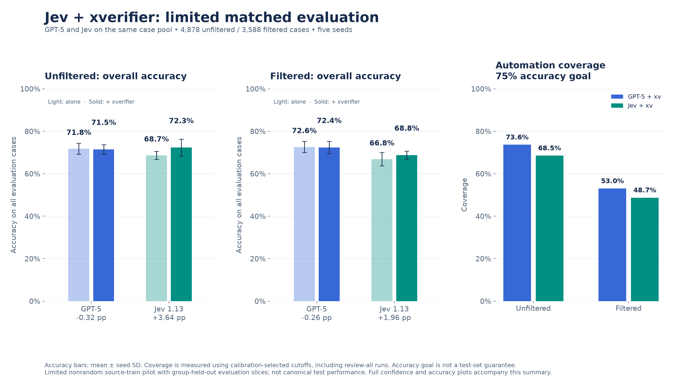
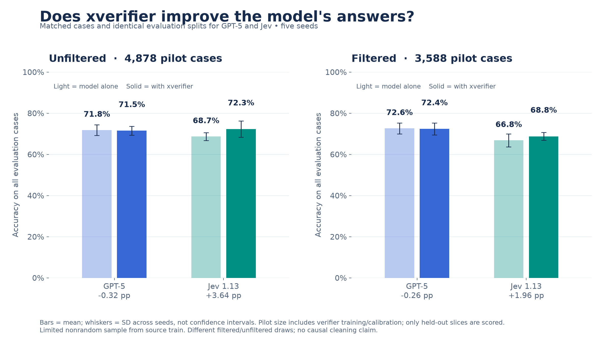
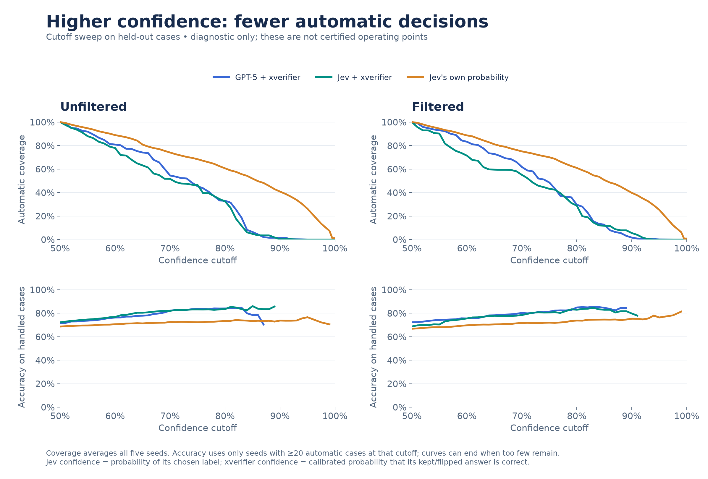
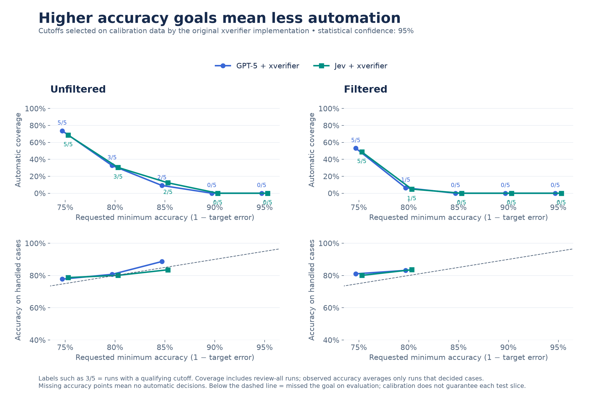
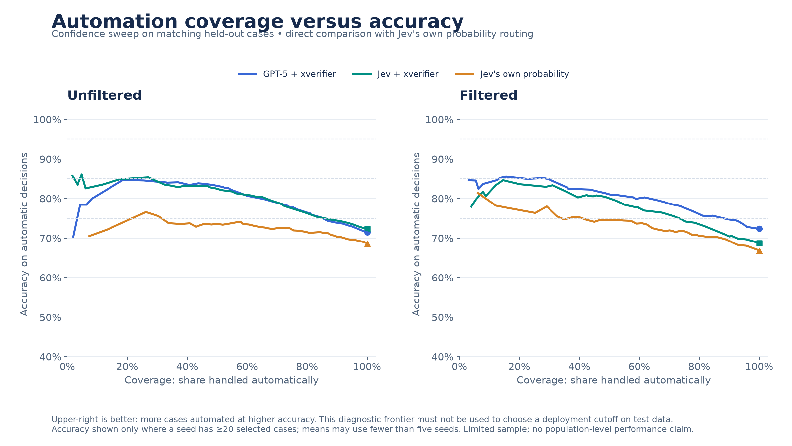

# Jev and GPT-5 with the original xverifier: limited matched pilot

Jev was evaluated on **4,878 unfiltered** and **3,588 filtered** cases from the earlier GPT pilot, after excluding Jev prompt-development overlaps. Both models use the same evaluation cases within each dataset and seed.

In this pilot, xverifier raised Jev's mean accuracy by **3.64 percentage points unfiltered** and **1.96 points filtered**. GPT-5's mean accuracy changed slightly downward. These are measured pilot differences, not a claim of reliable population improvement.

## Numbers for presentation

| Dataset | Model | Pilot rows | Evaluation cases per seed | Model alone | With xverifier | Change |
| --- | --- | ---: | ---: | ---: | ---: | ---: |
| Unfiltered | GPT-5 | 4,878 | 352–421 | 71.80% | 71.48% | -0.32 pp |
| Unfiltered | Jev 1.13 | 4,878 | 352–421 | 68.66% | 72.30% | +3.64 pp |
| Filtered | GPT-5 | 3,588 | 292–299 | 72.62% | 72.36% | -0.26 pp |
| Filtered | Jev 1.13 | 3,588 | 292–299 | 66.80% | 68.75% | +1.96 pp |

Accuracy is the mean across five seeds. The plot's whiskers show **seed standard deviation**, not confidence intervals. Sample size includes verifier training and calibration; accuracy is scored only on the held-out evaluation slices.

## Automatic decisions at each accuracy goal

Coverage = the share automatically decided; remaining cases go to human review. Observed accuracy applies only to those automatic decisions. It is not the same as overall model accuracy.

### Unfiltered

| Requested accuracy | GPT + xv coverage | GPT + xv observed accuracy | Runs with cutoff | Jev + xv coverage | Jev + xv observed accuracy | Runs with cutoff |
| --- | ---: | ---: | ---: | ---: | ---: | ---: |
| 75% | 73.65% | 77.74% | 5/5 | 68.52% | 78.72% | 5/5 |
| 80% | 32.67% | 80.71% | 3/5 | 30.39% | 80.10% | 3/5 |
| 85% | 9.13% | 88.67% | 2/5 | 12.29% | 83.54% | 2/5 |
| 90% | 0.00% | — | 0/5 | 0.00% | — | 0/5 |
| 95% | 0.00% | — | 0/5 | 0.00% | — | 0/5 |

### Filtered

| Requested accuracy | GPT + xv coverage | GPT + xv observed accuracy | Runs with cutoff | Jev + xv coverage | Jev + xv observed accuracy | Runs with cutoff |
| --- | ---: | ---: | ---: | ---: | ---: | ---: |
| 75% | 53.05% | 81.04% | 5/5 | 48.71% | 80.05% | 5/5 |
| 80% | 6.35% | 83.16% | 1/5 | 4.88% | 83.56% | 1/5 |
| 85% | 0.00% | — | 0/5 | 0.00% | — | 0/5 |
| 90% | 0.00% | — | 0/5 | 0.00% | — | 0/5 |
| 95% | 0.00% | — | 0/5 | 0.00% | — | 0/5 |

Coverage means include review-all runs. Observed accuracy averages only runs with automatic decisions. A dash means no automatic decisions, not zero accuracy. A qualifying calibration cutoff can still miss its accuracy goal on a finite evaluation slice. The 95% statistical confidence setting is distinct from both the requested accuracy goal and each case's confidence score.

## Presentation plots

### One-slide overview

### Overall model accuracy

### Confidence, coverage, and accuracy

The orange series routes cases using Jev's probability of its chosen label. The green and blue series use xverifier's calibrated probability that its final, possibly flipped answer is correct. These scores have the same nominal range but can have different calibration. Raising the cutoff does not mathematically guarantee better observed accuracy.

### Calibration-selected accuracy goals

These points come from the original implementation's calibration-selected cutoffs. Labels count qualifying runs out of five; evaluation accuracy below the diagonal misses the requested goal.

### Automation tradeoff

The confidence sweeps and tradeoff curves are **diagnostic**, not certified operating points. They use fixed cutoffs chosen before inspecting the curves, not optimized test cutoffs. Coverage averages all five runs. Accuracy omits seeds with fewer than 20 selected cases at a cutoff, so a point can average fewer than five runs. Their exact denominators are in `confidence_sweep.csv`. Sparse accuracy curves can end before coverage reaches zero. These curves must not be used to tune a deployment cutoff on evaluation data.

## Method and limits

- Original implementation: [thiago-cs-ai/xverifier at 241fcf3](https://github.com/thiago-cs-ai/xverifier/tree/241fcf3e068771fd23522b582f72e4e87d07fce8). The installed package's `runner.run` produces every native seed/aggregate result; no verifier source or mathematics were changed. No writes were made to that GitHub repository.
- GPT predictions are reused from the previous pilot: `gpt-5-2025-08-07`, existing four-example prompt, minimal reasoning. No new GPT calls were made.
- Jev: `jev-1.13.0`, the earlier selected `focused` zero-shot Choice prompt, pinned and saved in `jev_prompt.json`. Only case `text` is sent; labels, row IDs, and `full_text` are not sent. The model returns a label and two class probabilities. No prompt changes or test-driven selection occurred.
- 3,723 new unique-text Jev predictions; repeated exact text reuses one prediction. API prediction coverage is 100% of the eligible limited sample. This is separate from xverifier automation coverage. Input usage: 2,360,355 tokens; estimated Jev cost **$0.0991** at $0.042/M input tokens, output free. [TypeSafe model reference](https://docs.typesafe.ai/models).
- The earlier GPT sample had 4,884 unfiltered rows. Excluding Jev development cases, exact-text overlaps, and their near-duplicate groups removes 6 rows. Previous GPT few-shot/development exclusions remain inherited. Exclusions were frozen before Jev evaluation. IDs are in `run_plan.json`.
- Both models are rerun through xverifier on that common eligible subset. This changes the input groups and random draw versus the earlier GPT-only report, so the new GPT results can differ from that report. The earlier report remains preserved.
- Unfiltered and filtered draw their groups separately. GPT versus Jev comparisons are matched within a dataset, but filtered versus unfiltered is not a paired or causal cleaning comparison.
- Source: pinned `Persius/imr-appeals` and `utcompliance1/imr-appeals-cleaned` snapshots from the preceding report. This is a nonrandom completion/prefix pilot originating in the source **train** split. Xverifier creates its own group-held-out evaluation slices. It is not performance on the canonical test split or the full dataset.
- Representations: the same pinned, normalized 384-dimensional MiniLM text embeddings as the GPT pilot; no labels in embeddings. Row-ID joins are checked explicitly. Source near-duplicate groups remain intact in training/calibration/evaluation and cross-fitting. Exact duplicate text is checked to remain disjoint across roles.
- Five seeds `[42, 123, 456, 789, 1024]`; original defaults: draw split, calibration fraction 0.274, evaluation fraction 0.082, linear C=1 probe, maximum 256 PCA components, minimum 40 cases per verdict, five-fold Venn–Abers, flip threshold 0.5, error targets 25/20/15/10/5%, cutoff-selection confidence 95%. Only the judge verdict differs between GPT and Jev row files within a dataset.
- GPT and Jev use different established prompt strategies (four-example versus focused zero-shot). The figures compare those practical pipelines; they do not isolate an intrinsic model-quality effect. The five seeds share cases, so they are not five independent population samples. Tiny differences do not establish reliable improvements.

## Artifacts and replay

`presentation_numbers.csv` and `operating_points.csv` contain presentation values. `summary.json` includes seed SD and flip counts. All four experiment folders contain the original seed and aggregate outputs plus evaluation predictions/confidences. `confidence_sweep.csv` stores every cutoff/seed denominator. `matched_sample.csv`, `run_plan.json`, `verification.json`, and the compressed Jev cache preserve provenance. Large NPZ row files are ignored by Git. Each figure is available as PNG and editable SVG.

The preparation script uses the prior pinned cases/embeddings. To repeat collection on the same limited case pool, run `collect_jev.py --work <work-dir> --env-file <key-file>`; it caps new calls at 4,000 and resumes its cache. Then run `evaluate.py --work <work-dir>` in an unused output checkout, followed by `plot_results.py` and `write_report.py`. Replaying a saved cache does not need further API calls. `requirements-lock.txt` records the measured environment. The original implementation refuses to overwrite output folders.
